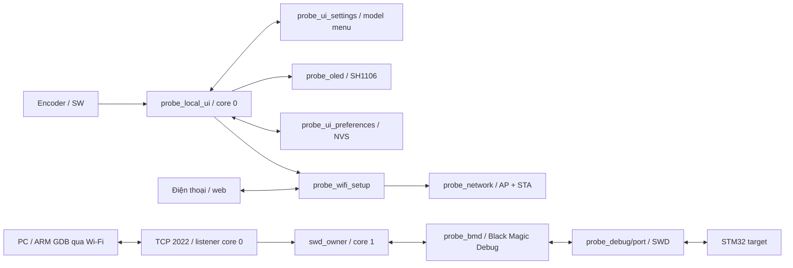

# Firmware MAGIC DEBUGGER TOOL

Hướng dẫn đọc và chỉnh firmware ESP32 trong VS Code. Mô tả source hiện tại ngày
**26/11/2026**, chạy trên **ESP32-S3 N16R8**, ESP-IDF **v6.1**, Black Magic Debug **v2.1.0**.
ESP32 làm probe nhận lệnh GDB qua Wi-Fi/TCP và giao tiếp với STM32 qua SWD.

## Bắt đầu trong VS Code

Từ thư mục `01_source`, mở workspace bằng:

```powershell
..\open-vscode.ps1
```

Script mở [esp32-probe.code-workspace](../esp32-probe.code-workspace) bằng profile riêng
**ESP32 Probe**, đồng thời chuẩn bị đường dẫn SDK cho extension. Các extension được
khuyến nghị là ESP-IDF, C/C++ và CMake syntax.

- `Ctrl+Shift+B`: build firmware Debug.
- `Terminal → Run Task → ESP32: Flash`: nạp qua USB, cổng mặc định COM9.
- `ESP32: Monitor`: mở console; `Ctrl+]` để thoát và nhả COM trước lần nạp tiếp theo.
- `F5`: build, nạp và debug **ESP32 probe** qua USB-JTAG. Debug ứng dụng **STM32** dùng
  ARM GDB/Cortex-Debug qua TCP 2022, xem [hướng dẫn STM32](../02_document/12_vscode_debug.md).

Các lệnh bên dưới đều chạy tại thư mục `01_source`:

```powershell
.\tools\dev.ps1 build
.\tools\dev.ps1 -p COM9 -b 460800 flash
.\tools\dev.ps1 -p COM9 monitor --no-reset
```

Để dùng trực tiếp `idf.py` trong PowerShell hiện tại:

```powershell
. .\tools\terminal.ps1
idf.py build
idf.py -p COM9 monitor --no-reset
```

Dấu chấm đầu dòng là thao tác dot-source. Script này nạp toolchain cục bộ và định nghĩa
`idf.py` gọi qua `dev.ps1`, nên vẫn dùng đúng cấu hình `build-vscode`. Khi có dấu nhắc
`PS ...>` là đang ở PowerShell; lệnh firmware như `status` chỉ gõ bên trong monitor.

## Cây thư mục

```text
01_source/
├── main/
│   ├── main.c                    # app_main(): ghép và khởi động các dịch vụ
│   └── CMakeLists.txt            # Dependency của entry point
├── components/
│   ├── probe_board/              # Profile N16R8, pin map/Kconfig, kiểm tra phần cứng
│   ├── probe_bmd/                # Build adapter và shim cho Black Magic Debug
│   ├── probe_debug/              # TCP/GDB, task sở hữu SWD và port phần cứng
│   ├── probe_network/            # Wi-Fi AP/STA, lưu profile router trong NVS
│   ├── probe_wifi_setup/         # Web điện thoại, scan Wi-Fi, provision, Ping router
│   ├── probe_local_ui/           # Điều phối UI, model menu và lưu OLED % vào NVS
│   ├── probe_oled/               # SH1106 I2C, framebuffer, font và startup animation
│   ├── probe_encoder/            # Poll GPIO/nút, decoder xoay độc lập
│   ├── probe_console/            # Lệnh chẩn đoán/cấu hình qua serial
│   ├── probe_state/              # Snapshot trạng thái dùng chung giữa các task
│   └── probe_sd/                 # SPI2, microSD/FAT, API và mutex truy cập thẻ
├── external/
│   └── blackmagic/               # Git submodule backend BMD v2.1.0
├── cmake/
│   └── project_options.cmake     # C17/GNU17, warnings, -Werror, GCC analyzer
├── tests/                        # Bài thử host, SDK stubs và kiểm thử trang web
├── tools/                        # Setup, môi trường, build và script kiểm thử
├── tooling/                      # Dependency/constraints được quản lý bằng Git
├── .tooling/                     # SDK submodule, Python, compiler và công cụ cục bộ
├── .cache/                       # Log, host-test executable, backup; không commit
├── build-vscode/                 # Build Debug dùng trong VS Code; được sinh tự động
├── build/                        # Build CLI riêng; được sinh tự động
├── CMakeLists.txt                # Project, phiên bản firmware, kiểm tra SDK/target
├── partitions.csv                # Bố cục flash 16 MiB
├── sdkconfig.defaults            # Cấu hình nền của firmware
├── sdkconfig.vscode.defaults     # Overlay Debug và console USB native
└── tooling.lock.json             # Commit SDK/BMD và phiên bản bộ công cụ được ghim
```

Trong mỗi component, `include/` chứa API công khai; header cạnh file `.c` hoặc trong
`port/` là nội bộ. CMake của component khai báo source cần biên dịch và các dependency.

## Muốn chỉnh gì thì mở file nào?

| Phần cần chỉnh | File chính | Vai trò |
|---|---|---|
| Thứ tự khởi động, chính sách lỗi | [main/main.c](main/main.c) | Gọi các dịch vụ từ `app_main()` |
| Trang menu, tiêu đề, dòng chọn, Back, preset | [probe_ui_settings.c](components/probe_local_ui/probe_ui_settings.c), [header](components/probe_local_ui/probe_ui_settings.h) | Model thuần C; xử lý input và tạo tám dòng chữ |
| Nhận encoder, lịch vẽ, gọi dịch vụ từ UI | [probe_local_ui.c](components/probe_local_ui/probe_local_ui.c) | Task sở hữu màn hình; nối model với phần cứng/NVS/mạng |
| Lưu/đọc mức OLED | [probe_ui_preferences.c](components/probe_local_ui/probe_ui_preferences.c) | NVS namespace `probe_ui`, khóa u8 `oled_pct` |
| Driver màn hình, vị trí pixel, animation | [probe_oled.c](components/probe_oled/probe_oled.c) | SH1106, truyền page I2C, vẽ chữ/startup và contrast |
| Font | [font8x8_basic_tr.h](components/probe_oled/font8x8_basic_tr.h) | Bảng font 8×8, 128 glyph |
| Encoder/nút: GPIO, polling | [probe_encoder.c](components/probe_encoder/probe_encoder.c) | Đọc chân và đưa sự kiện vào queue |
| Encoder: giải mã xoay/debounce | [probe_encoder_decode.c](components/probe_encoder/probe_encoder_decode.c) | Logic độc lập SDK, có thể kiểm thử host |
| AP, STA, kết nối lại và profile router | [probe_network.c](components/probe_network/probe_network.c) | Driver Wi-Fi và namespace NVS `probe_wifi` |
| Nội dung trang cấu hình điện thoại | [wifi_portal.html](components/probe_wifi_setup/wifi_portal.html) | HTML/CSS/JavaScript nhúng, giao diện tiếng Anh |
| HTTP API, scan, lưu mạng, Ping | [probe_wifi_setup.c](components/probe_wifi_setup/probe_wifi_setup.c) | HTTP trên AP, worker cấu hình và trạng thái bất đồng bộ |
| Decode form/escape JSON | [probe_wifi_form.c](components/probe_wifi_setup/probe_wifi_form.c) | Logic có giới hạn kích thước, kiểm thử host |
| Thêm lệnh serial | [probe_console.c](components/probe_console/probe_console.c) | Parse lệnh và gọi API của component tương ứng |
| Dịch vụ GDB, session và queue | [probe_debug.c](components/probe_debug/probe_debug.c) | Listener TCP và task sở hữu phiên debug |
| Timing/GPIO giao dịch SWD | [probe_swd.c](components/probe_debug/port/probe_swd.c) | Port SWD trên ESP32, chỉ được owner gọi |
| Cầu nối backend BMD | [probe_platform.c](components/probe_debug/port/probe_platform.c), [probe_bmd](components/probe_bmd/) | Platform hooks và adapter build upstream |
| Trạng thái hiển thị/chẩn đoán | [probe_state.h](components/probe_state/include/probe_state.h), [probe_state.c](components/probe_state/probe_state.c) | API cập nhật/copy snapshot có đồng bộ |
| microSD | [probe_sd.c](components/probe_sd/probe_sd.c) | Mount/unmount, list/read/write có giới hạn |
| Pin mặc định, tính năng phần cứng | [Kconfig](components/probe_board/Kconfig), [sdkconfig.defaults](sdkconfig.defaults) | Kconfig cố định pin PCB; defaults chọn profile/tính năng |
| Dung lượng và địa chỉ flash | [partitions.csv](partitions.csv) | Phân vùng ESP32 và các vùng dữ liệu dành sẵn |

Ví dụ thêm một trang OLED: khai báo trạng thái/trang trong `probe_ui_settings.h`, xử lý
chọn/xoay/Back và render trong `probe_ui_settings.c`. Nếu trang cần dữ liệu thật, nối
snapshot/yêu cầu dịch vụ trong `probe_local_ui.c`. Driver `probe_oled.c` nhận các dòng
đã render, nên thay đổi nội dung menu thường nằm ở model.

## Luồng hoạt động



Thứ tự trong `app_main()`:

1. Kiểm tra chip ESP32-S3 hai lõi, flash 16 MiB, PSRAM 8 MiB và pin PCB.
2. Khởi tạo NVS; lỗi hết trang/sai phiên bản đi qua nhánh phục hồi của application.
3. Khởi động AP/STA và đọc profile router đã lưu.
4. Khởi động SWD owner trên core 1 rồi listener GDB/TCP trên core 0.
5. Khởi động dịch vụ web cấu hình Wi-Fi.
6. Tạo queue/input encoder và task UI; UI đọc mức OLED từ NVS, chạy startup rồi Settings.
7. Thử mount microSD tại `/sdcard`.
8. Mở console serial.

UI, encoder, console và các dịch vụ điều phối chạy trên core 0. Một task `swd_owner`
ở core 1 sở hữu backend và giao dịch SWD. UI đọc snapshot qua `probe_state` hoặc API
dịch vụ; thao tác target đi qua dịch vụ debug. Khóa snapshot chỉ bảo vệ copy ngắn,
không giữ trong lúc truyền OLED/chờ I/O. Ghi NVS của OLED đợi giữ được quyền cấu hình
khi probe rảnh; có GDB thì ghi được hoãn đến sau phiên.

OLED/microSD thiếu hoặc lỗi được xử lý nonfatal. Lỗi khởi tạo web cũng không dừng
probe; các điều kiện nền bắt buộc được application kiểm tra riêng.

## Cấu hình, build và file sinh ra

| File/thư mục | Cách dùng |
|---|---|
| `sdkconfig.defaults` | Cấu hình nền được commit: N16R8, flash/PSRAM, pin và ngoại vi |
| `sdkconfig.vscode.defaults` | Overlay cho Debug và console USB native |
| `sdkconfig.vscode` | Cấu hình đã sinh của VS Code, không commit |
| `sdkconfig` | Cấu hình đã sinh của build CLI, không commit |
| `build-vscode/` | App/ELF, partition binary, compile database của Debug |
| `build/` | Kết quả của `tools/idf.ps1`, độc lập với `build-vscode` |
| `tooling.lock.json` | Ghim SDK/BMD và công cụ; thay dependency theo quy trình setup |

Luồng VS Code dùng `tools/dev.ps1`. Luồng CLI riêng dùng `tools/idf.ps1`; hai build
có cấu hình và đầu ra riêng. IntelliSense của workspace đọc
`build-vscode/compile_commands.json`, nên build/reconfigure sau khi đổi source/CMake.

```powershell
# Sau khi thêm file .c hoặc đổi CMake/Kconfig
.\tools\dev.ps1 reconfigure build

# Điều chỉnh cấu hình build đang dùng
.\tools\dev.ps1 menuconfig

# In bảng phân vùng
.\tools\dev.ps1 partition-table
```

Thêm `.c` vào `SRCS` trong CMakeLists của component. API dùng bên ngoài component đặt
trong `include/`; khai báo dependency công khai bằng `REQUIRES`, dependency nội bộ bằng
`PRIV_REQUIRES`. Không sửa các file sinh ra trong `build*/`.

Giá trị đã có trong `sdkconfig.vscode` có thể ưu tiên hơn defaults: sau khi thay defaults,
đối chiếu cấu hình thực tế bằng `menuconfig`/file đã sinh. Hướng dẫn môi trường và máy mới
nằm trong [Build và bộ công cụ](../02_document/02_build_and_tooling.md).

## Phần đang hoạt động và phần cần nối tiếp

| Hạng mục | Trạng thái source hiện tại |
|---|---|
| SH1106 128×64, font 8×8, xoay 180°, startup | Đã có driver và animation; menu 8 dòng × 16 ký tự |
| OLED % | Preview trực tiếp; nhấn chốt lưu NVS, boot khôi phục; 50% là dự phòng |
| WiFi config trên OLED | Header cách một hàng; STA/NONE, setup ON/OFF, IP/AP/PW cùng lề khi ON, Back |
| Khi không có STA | Hiện NONE, giữ web setup ON để cấu hình |
| Web điện thoại | Nhập router SSID/password, scan/chọn mạng, đọc trạng thái và Ping gateway |
| AP của probe | `MAGIC-PROBE`, mật khẩu `1234567890`, web tại `http://192.168.4.1` khi setup ON |
| GDB/TCP | TCP 2022; F103 đã qua scan/attach, đọc thanh ghi/bộ nhớ, step, hardware breakpoint, run/interrupt ở 400 kHz |
| Ví dụ nạp STM32 | [PC13 blink](examples/stm32f103_pc13_blink/): đã load/verify qua Wi-Fi/SWD, chu kỳ 500 ms |
| SWD Settings | Freq kHz / NRST / Reset ms / SWO lưu ý định trong RAM; chưa áp dụng vào backend |
| Flash REMOTE/SDCARD, Target UART/I2C/SPI, Link BLE/ESP-NOW | Các lựa chọn UI; những backend/chế độ này chưa được triển khai tương ứng |
| microSD | Mount FAT và thao tác console; job nạp STM32 độc lập từ SD chưa triển khai |
| `fw_1`/`fw_2`, FAT nội bộ, OTA và coredump | Đã dành phân vùng; chưa có đầy đủ chức năng sử dụng các vùng này |

OLED dùng NVS namespace `probe_ui`, khóa `oled_pct` (u8). Chỉ chấp nhận mức
10/25/50/75/100; xoay và hủy không ghi flash. Profile router dùng namespace `probe_wifi`.
Các lựa chọn mode/SWD còn ở RAM. Hiệu ứng startup có chuỗi contrast riêng trước khi
áp dụng mức OLED đã khôi phục cho menu.

ARM GDB đã nạp/verify ví dụ F103 PC13 và dừng đúng `main` với source/symbols. Phiên VS Code
theo source/biến và các model STM32 khác còn cần nghiệm thu; xem
[bằng chứng tích hợp](../02_document/09_integration_validation.md).

## Phần cứng và flash

Pin GPIO theo PCB revision C:

| Nhóm | GPIO |
|---|---|
| SWDIO / SWCLK / SWO / nRST | 4 / 5 / 6 / 7 |
| OLED SDA / SCL | 8 / 9 |
| Encoder A / B / SW | 15 / 16 / 17 |
| microSD CS / MOSI / SCK / MISO / DETECT_N | 38 / 39 / 40 / 41 / 42 |
| USB D− / D+ | 19 / 20 |
| UART0 TX / RX | 43 / 44 |

GPIO được Kconfig cố định theo PCB. Đấu nối và giới hạn phần cứng xem
[Phần cứng và local UI](../02_document/05_hardware_and_local_ui.md).

Flash N16 được chia như sau; R8 là PSRAM riêng:

| Nhãn | Offset | Dung lượng | Vai trò |
|---|---:|---:|---|
| `nvs` | `0x009000` | 64 KiB | Profile và tham số lưu lâu dài |
| `phy_init` | `0x019000` | 8 KiB | Vùng PHY dành sẵn |
| `otadata` | `0x01B000` | 8 KiB | Metadata chọn slot ESP32 |
| `ota_1` | `0x020000` | 4 MiB | ESP32 app, subtype SDK ota_0 |
| `ota_2` | `0x420000` | 4 MiB | ESP32 app, subtype SDK ota_1 |
| `coredump` | `0x820000` | 256 KiB | Vùng dump lỗi dành sẵn |
| `fw_1` | `0x860000` | 2 MiB | Ảnh `.bin` STM32, data partition |
| `fw_2` | `0xA60000` | 2 MiB | Ảnh `.bin` STM32, data partition |
| `storage` | `0xC60000` | 3,625 MiB | FAT nội bộ dành sẵn |

Bootloader/bảng phân vùng và 12 KiB căn chỉnh trước app nằm ngoài các dòng dữ liệu
trên; vùng cuối kết thúc đúng tại 16 MiB. SDK có thể cảnh báo nhãn `ota_1`/`ota_2`
khác số subtype; mapping 1→0 và 2→1 là chủ ý của bảng hiện tại.

Flash args do SDK sinh theo CSV. Khi đổi offset/kích thước vùng chứa dữ liệu, thực hiện
chuyển dữ liệu theo [hướng dẫn phân vùng/NVS](../02_document/02_build_and_tooling.md#cấu-hình-bộ-nhớ).

## Kiểm thử khi chỉnh source

Host test bên dưới cần GCC trên PATH và Node.js cho bài JavaScript. Chúng dùng mã
production với SDK stubs/mô hình, không truy cập PCB:

```powershell
& .\.tooling\python-env\Scripts\python.exe .\tools\test_oled_host.py
& .\.tooling\python-env\Scripts\python.exe .\tools\test_ui_preferences_host.py
& .\.tooling\python-env\Scripts\python.exe .\tools\test_wifi_form_host.py
& .\.tooling\python-env\Scripts\python.exe .\tools\test_sd_host.py
node .\tests\wifi_portal_test.cjs
```

`tests/encoder_test.c` kiểm tra decoder; `tools/test_board_config.py` đối chiếu pin với
netlist KiCad. Các script runtime/USB/GDB trong `tools/` dùng phần cứng thật, có tham số
riêng; xem `--help` và [tài liệu nghiệm thu](../02_document/09_integration_validation.md).

`tools/test_stm32_debug.py <probe-ip>` kiểm tra F103 qua Wi-Fi/SWD: scan, attach,
đọc nhận dạng/thanh ghi và đọc lặp flash/RAM rồi detach. Thêm `--exercise-core` để thử
step, breakpoint phần cứng và run/interrupt. Công cụ không ghi flash hoặc RAM.
Ngày 26/11 đã xử lý BAT54C lắp nhầm vị trí BAT54S, trở về firmware chính và thử đạt
scan/attach, đọc nhận dạng/thanh ghi/bộ nhớ, step, hardware breakpoint và run/interrupt
trên F103 ở 400 kHz; ARM GDB cũng đã kết nối thành công. Các phép thử đó chỉ đọc.
Sau đó đã nạp và verify [ví dụ PC13](examples/stm32f103_pc13_blink/), dừng tại `main`
và đọc biến bằng ARM GDB với ELF khớp. Xem [quy trình](../02_document/12_vscode_debug.md).

Sau khi đổi mã C, build bằng SDK được ghim rồi kiểm tra phần chức năng liên quan trên
mạch. Mã dự án dùng C17; adapter Xtensa/FreeRTOS dùng GNU17, bật `-Werror` và GCC analyzer.
Quy ước là indent 4 dấu cách, Allman, khoảng 100 cột; comment mã nguồn tiếng Anh theo
Doxygen. Chi tiết: [quy chuẩn mã](../02_document/06_coding_standard.md).

## Dependency và tài liệu đọc tiếp

`external/blackmagic` và `.tooling/esp-idf-v6.1` là Git submodule đã ghim commit.
Mã port/adapter của dự án nằm trong `components/probe_debug` và `components/probe_bmd`;
giữ thay đổi tích hợp ở đây để dễ theo dõi khi cập nhật upstream. Python/compiler và
log/build nằm cục bộ, không commit credential, ảnh backup flash hay nội dung `.cache`.

- [Logic tổng thể và luồng debug](../02_document/10_project_logic.md)
- [Phần cứng, OLED/encoder và Wi-Fi setup](../02_document/05_hardware_and_local_ui.md)
- [Build, profile VS Code và chuyển phân vùng](../02_document/02_build_and_tooling.md)
- [microSD](../02_document/11_sd_storage.md)
- [VS Code/Cortex-Debug cho STM32](../02_document/12_vscode_debug.md)
- [Tooling lock/dependency](tooling/README.md)
