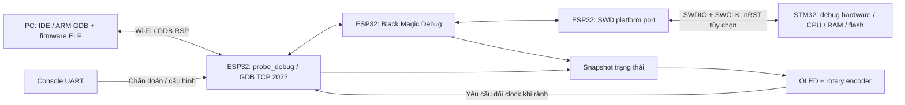
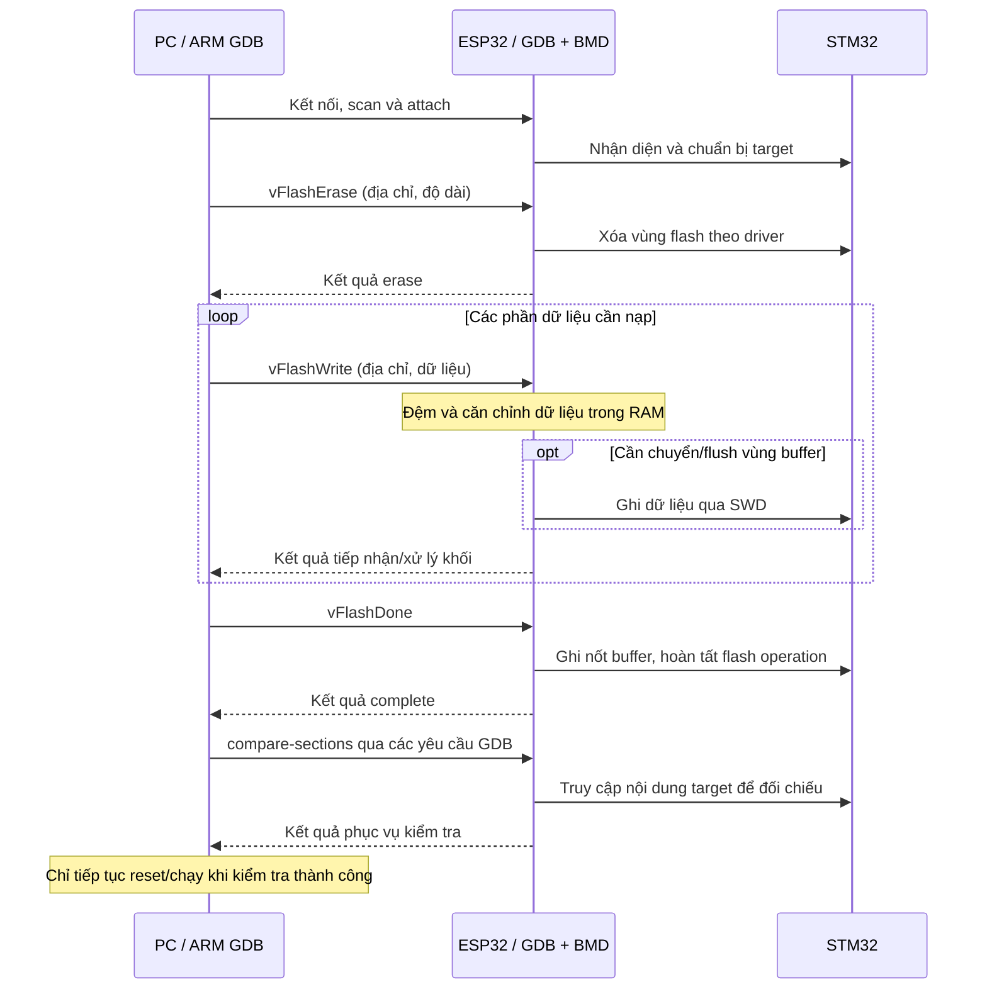

# Logic hoạt động của ESP32 STM32 Debug

Ngày cập nhật: 30/10/2026. Phạm vi: firmware `0.1.0-dev1`, ESP32-S3 N16R8,
ESP-IDF v6.1 và Black Magic Debug v2.1.0.

Tài liệu mô tả logic đã có trong source và cách sử dụng dự kiến trên STM32.
Các thao tác debug/nạp flash trên target thật vẫn chờ nghiệm thu; kết quả đã thử nằm trong
[báo cáo tích hợp](09_integration_validation.md).

## 1. Mục tiêu và nguyên lý

ESP32-S3 đóng vai trò probe đặt cạnh board STM32. Máy tính gửi yêu cầu debug hoặc dữ liệu
nạp firmware qua Wi-Fi. ESP32 xử lý yêu cầu và giao tiếp với phần cứng debug bên trong STM32
bằng SWD. Dữ liệu trả về đi theo chiều ngược lại để máy tính hiển thị hoặc kiểm tra.

Hai chức năng chính dùng chung một đường truyền và một backend:

| Chức năng | Công việc |
|---|---|
| Debug | Nhận diện target, attach/detach, dừng/chạy CPU, single-step, breakpoint, đọc thanh ghi và bộ nhớ |
| Nạp firmware STM32 | Nhận dữ liệu từ PC theo từng khối, xóa vùng flash cần thiết, ghi, kiểm tra rồi reset/chạy |

Máy tính cần GDB cho ARM, chẳng hạn `arm-none-eabi-gdb`, và firmware được build đúng cho
target. IDE có thể làm giao diện điều khiển GDB. File ELF trên PC cung cấp địa chỉ các
section, symbol và thông tin debug để liên hệ tên biến/dòng code với bộ nhớ STM32.

## 2. Kiến trúc tổng thể



Wi-Fi vận chuyển lệnh và kết quả. Xung SWCLK, dữ liệu SWDIO và đổi chiều tín hiệu được
ESP32 thực hiện tại board; mỗi cạnh SWD không phải đi một vòng qua Wi-Fi.
Độ trễ mạng ảnh hưởng thời gian hoàn thành yêu cầu, còn tốc độ/timing SWD do port trên ESP32 xử lý.

### Ranh giới giao thức

| Lớp | Vai trò |
|---|---|
| GDB Remote Serial Protocol — RSP | Biểu diễn yêu cầu đọc/ghi bộ nhớ, điều khiển CPU, breakpoint và nạp flash |
| TCP qua Wi-Fi | Vận chuyển luồng byte hai chiều giữa GDB và ESP32 |
| Black Magic Debug — BMD | Giải mã yêu cầu GDB, quản lý target và gọi driver phù hợp |
| SWD và ADI | Truy cập debug port/access port của ARM để thao tác target |
| Driver STM32 | Thực hiện các thao tác phụ thuộc chip, đặc biệt tổ chức và thuật toán flash |

TCP là luồng byte: một lần `recv()` có thể nhận một phần packet RSP hoặc nhiều phần gộp lại.
Lớp nhận phải giữ phần dữ liệu chưa dùng và để parser RSP xác định ranh giới packet.
Checksum/ACK của RSP và việc kiểm tra nội dung flash sau nạp là các bước có mục đích riêng.

## 3. Trách nhiệm của các component

| Thành phần | Trách nhiệm và quyền sở hữu |
|---|---|
| `main` | Ghép dịch vụ và quyết định dừng khởi động khi điều kiện nền thất bại |
| `probe_board` | Kiểm tra profile S3 hai lõi, flash 16 MiB, PSRAM 8 MiB và pin không trùng/chân dành riêng |
| `probe_network` | Khởi tạo Wi-Fi AP/STA, đọc/lưu cấu hình mạng trong NVS, cập nhật kết nối/IP |
| `probe_debug` | Nhận client TCP, sở hữu phiên GDB, chạy backend và port SWD trong một task |
| `probe_bmd` | Build adapter và libc/platform shim cho backend upstream được ghim bằng submodule |
| `probe_state` | Cung cấp snapshot trạng thái nhất quán giữa các task |
| `probe_console` | Nhận lệnh UART để xem trạng thái, cấu hình mạng và gửi yêu cầu clock |
| `probe_encoder` | Đọc A/B/nút nhấn, giải mã thành sự kiện xoay/chọn/quay lại |
| `probe_oled` | Sở hữu I2C/panel SSD1306 và framebuffer chữ trong task UI |
| `probe_local_ui` | Xử lý menu, đọc snapshot và gửi yêu cầu cấu hình qua API dịch vụ debug |

Backend nằm tại `01_source/external/blackmagic`; mã dự án không sửa trực tiếp checkout
upstream. Lớp port nối các API backend với GPIO, timing và transport của ESP-IDF.

## 4. Luồng khởi động

Thứ tự trong [`app_main()`](../01_source/main/main.c):

1. Kiểm tra chip, flash, PSRAM và cấu hình chân của profile N16R8.
2. Khởi tạo NVS. Nếu SDK báo NVS hết trang hoặc sai phiên bản, application xóa NVS rồi
   khởi tạo lại; cấu hình mạng đã lưu sẽ mất trong trường hợp phục hồi này.
3. Khởi tạo network, AP dự phòng và STA nếu có profile đã lưu.
4. Tạo task sở hữu SWD trên core 1, khởi tạo GPIO/timing và nhận kết quả khởi tạo.
5. Khi SWD khởi tạo thành công, tạo task TCP listener trên core 0.
6. Tạo queue sự kiện, input encoder và task giao diện OLED.
7. Tạo console UART để chẩn đoán và cấu hình.

Application kiểm tra lỗi khởi tạo bằng `ESP_ERROR_CHECK`. Sai profile, lỗi storage hoặc
lỗi thiết lập dịch vụ bắt buộc có thể làm dừng/reset khởi động. Thiếu OLED được xử lý
không nghiêm trọng bên trong task UI nên không làm dừng probe.

Wi-Fi kết nối và DHCP diễn ra bất đồng bộ: log dịch vụ đã khởi chạy không đồng nghĩa
STA đã có IP. Tương tự, TCP listener báo sẵn sàng sau khi bind/listen thực sự thành công.

## 5. Task, đồng bộ và quyền sở hữu target

| Core | Công việc chính |
|---|---|
| Core 0 | Wi-Fi/lwIP theo cấu hình, chấp nhận client TCP, console, encoder và UI |
| Core 1 | Task `swd_owner`: xử lý phiên RSP/BMD và toàn bộ giao dịch SWD |

Task listener chỉ chấp nhận kết nối và chuyển socket qua queue. Sau đó chính task
`swd_owner` nhận/gửi dữ liệu RSP và thực hiện thao tác target; không có hai task cùng gọi backend.

Các nguyên tắc đồng bộ:

- Mỗi thời điểm chỉ một client GDB được giữ quyền điều khiển probe. Client thứ hai bị đóng kết nối.
- Cờ atomic `debug_busy` giữ chỗ cho phiên GDB hoặc cho một thao tác cấu hình mạng.
- Console phải giữ chỗ khi ghi NVS/đổi mạng để tránh xung đột với một phiên debug mới.
- Yêu cầu đổi clock từ UI/console đi qua queue. Chỉ task owner áp dụng giữa các phiên.
  API từ chối yêu cầu khi đang bận; `ESP_OK` ở API này có nghĩa yêu cầu đã vào queue.
- UI và console đọc bản sao từ `probe_state`; spinlock chỉ bảo vệ thao tác copy/cập nhật ngắn.
  Không giữ spinlock khi truyền I2C, chờ TCP hoặc thao tác SWD.
- Task UI sở hữu panel/framebuffer OLED; task input chỉ gửi sự kiện, không vẽ màn hình.

`probe_state` là dữ liệu quan sát cho hiển thị/chẩn đoán. Nó không thay thế queue hoặc
cơ chế giữ quyền điều khiển target.

## 6. Logic Wi-Fi và console

Firmware chạy AP và STA đồng thời:

- AP có tên dạng `STM32-PROBE-xxxx`, IP `192.168.4.1`; mật khẩu được tạo một lần và lưu NVS.
  AP vẫn hoạt động khi STA đã kết nối.
- STA đọc SSID/mật khẩu đã lưu, kết nối mạng và nhận IP qua DHCP. Khi mất kết nối,
  callback cập nhật snapshot rồi yêu cầu kết nối lại nếu profile còn được bật.
- Khi có IP, firmware cập nhật SSID/IP thật và ghi log kết nối. PC dùng địa chỉ truy cập
  được của probe để nối tới TCP 2022, có thể đổi cổng qua Kconfig.

Các lệnh console hiện có, UART 115200 baud:

| Lệnh | Hành vi |
|---|---|
| `help` | In danh sách lệnh |
| `status` | Xem mạng/IP, phiên GDB, tên target, clock danh định, OLED, lỗi và heap |
| `pins` | In pin map cấu hình |
| `wifi <SSID>\|<password>` | Lưu profile trong NVS và yêu cầu kết nối; bị từ chối khi probe đang bận |
| `ap` | Hiển thị SSID/mật khẩu AP khi có yêu cầu trực tiếp trên console |
| `clock <Hz>` | Gửi yêu cầu clock 1 kHz đến 8 MHz; chỉ áp dụng khi rảnh, không lưu NVS |

SSID hỗ trợ 1–32 byte, mật khẩu STA 8–63 byte. Console dùng dấu `|` làm phân cách nên
SSID có dấu này chưa được hỗ trợ qua cú pháp hiện tại. Console không echo credential đầu vào,
log tự động không in mật khẩu STA. NVS nguyên mẫu chưa được mã hóa.

## 7. Logic phiên debug

Luồng hoạt động dự kiến trên target thật:

1. GDB kết nối TCP tới probe và thương lượng tính năng RSP.
2. `monitor swd_scan` yêu cầu BMD quét SWD, nhận diện debug port/access port và target.
3. Khi scan đã liệt kê target, `attach 1` gắn phiên điều khiển với target số 1.
4. GDB gửi thao tác debug. BMD chuyển yêu cầu thành truy cập register/bộ nhớ hoặc điều khiển CPU.
5. Port SWD thực hiện truyền/nhận bit, turnaround và parity; kết quả trả về PC qua RSP.
6. Khi phiên kết thúc, owner giải phóng danh sách target, xóa trạng thái phiên,
   thả chân SWD và trả quyền cho client tiếp theo.

Ví dụ xem biến: PC dùng symbol trong ELF để xác định địa chỉ và kiểu của biến; probe đọc
các byte ở địa chỉ đó trên STM32 rồi gửi về để GDB hiển thị. ESP32 không cần giữ toàn bộ
source hoặc bảng symbol của ứng dụng STM32.

SWD mặc định bắt đầu ở 400 kHz. Port giới hạn yêu cầu theo khả năng timing được hiệu chỉnh
trong firmware. Clock hiển thị là giá trị danh định, chưa phải số đo dạng sóng bằng thiết bị đo.
Pin map và điều kiện đấu nối nằm trong [tài liệu phần cứng](05_hardware_and_local_ui.md).

## 8. Logic nạp firmware STM32 qua Wi-Fi

### 8.1. Truyền và nạp theo từng khối

**File firmware nằm trên PC. ESP32 nhận từng phần vào RAM tạm, xử lý qua backend rồi ghi
sang flash STM32 bằng SWD. Không có bước bắt buộc tải đủ toàn bộ file vào ESP32 trước khi nạp.**

```text
PC: firmware ELF
    → GDB tách địa chỉ và dữ liệu cần nạp
    → RSP qua TCP/Wi-Fi
    → RAM nhận/parse trên ESP32
    → buffer ghi flash của BMD
    → driver target và giao dịch SWD
    → flash STM32
```

ELF được GDB đọc trên PC; ESP32 nhận packet chứa địa chỉ/dữ liệu và lệnh thao tác target.
Firmware hiện không có chức năng nhận một file ELF hoàn chỉnh rồi lưu để nạp độc lập.

Buffer RX/TX của lớp TCP dự án có kích thước 1024 byte mỗi buffer. BMD có packet buffer
và buffer ghi riêng theo `writebufsize` của driver flash. Các kích thước này không có nghĩa
mỗi lần ghi STM32 đều đúng 1024 byte, hoặc mỗi packet TCP tương ứng một đơn vị ghi flash.

Một số dữ liệu được gom đến khi chuyển vùng buffer hoặc kết thúc thao tác mới ghi xuống
target. Vì vậy, nạp theo từng khối vẫn có bước đệm RAM và căn chỉnh theo phần cứng flash.

### 8.2. Trình tự erase, write và complete



Các hàm liên quan trong source upstream:

| Packet/hàm | Vai trò |
|---|---|
| `vFlashErase` / `target_flash_erase()` | Xóa vùng cần nạp theo memory map và driver |
| `vFlashWrite` / `target_flash_write()` | Nhận dữ liệu, chọn vùng flash và đưa qua cơ chế ghi có buffer |
| `flash_buffered_flush()` | Ghi phần buffer hợp lệ bằng đơn vị `writesize` của driver |
| `vFlashDone` / `target_flash_complete()` | Flush dữ liệu còn lại và hoàn tất chế độ flash |
| GDB `compare-sections` | Đối chiếu các section được nạp với firmware trên PC |

Phản hồi thành công của một packet write chưa có nghĩa toàn bộ firmware đã ghi và verify xong.
Quy trình phải hoàn tất các bước ghi còn lại và kiểm tra sau nạp.

### 8.3. Quy trình GDB dự kiến

Ví dụ trong `arm-none-eabi-gdb`, sau khi nối đúng phần cứng và xác nhận driver hỗ trợ chip:

```text
file firmware.elf
target extended-remote <probe-ip>:2022
monitor swd_scan
attach 1
load
compare-sections
kill
```

Chỉ attach nếu scan đã liệt kê target số 1. `load` gửi các phần cần nạp của firmware;
`compare-sections` dùng để đối chiếu sau nạp. Trong BMD, `kill` được dùng để reset target
và kết thúc điều khiển target; hành vi chạy sau reset còn phụ thuộc cấu hình boot của board.
Chu trình này cần được nghiệm thu trên STM32 thật trước khi công bố dùng ổn định.

### 8.4. Bộ nhớ ESP32 và điều kiện kết nối

| Tài nguyên | Vai trò hiện tại |
|---|---|
| RAM nội ESP32 | Task, queue, TCP/RSP và buffer thao tác target |
| Flash ESP32 | Firmware probe, NVS và các partition nền tảng |
| PSRAM 8 MiB | Đã khởi tạo/kiểm tra; dành khả năng mở rộng buffer lớn ở giai đoạn acquisition/trace |
| Flash STM32 | Chứa firmware ứng dụng được nạp qua SWD |

Partition hiện chưa có filesystem/kho lưu file firmware STM32. PSRAM không được dùng để
giữ toàn bộ ảnh firmware cho một lượt nạp độc lập sau khi PC ngắt kết nối.

PC và Wi-Fi cần duy trì trong quá trình nạp. Nếu kết nối mất sau khi đã erase hoặc ghi
một phần, STM32 có thể chứa firmware chưa hoàn chỉnh. Hiện chưa có cơ chế rollback,
tự tiếp tục từ vị trí ngắt hoặc bảo đảm cập nhật nguyên tử; cần kết nối lại và nạp/verify lại.

### 8.5. Hai loại firmware cần phân biệt

| Đối tượng cập nhật | Công cụ/đường truyền hiện tại |
|---|---|
| Firmware của ESP32 probe | `idf.ps1 ... flash`, esptool qua cổng USB-UART |
| Firmware ứng dụng STM32 | ARM GDB `load`, Wi-Fi → ESP32 → SWD |

Chức năng OTA cập nhật chính ESP32 chưa triển khai.

## 9. OLED, encoder và cấu hình cục bộ

Encoder được chọn là dạng cơ khí rời có nút nhấn theo ảnh người dùng cung cấp ngày
30/10/2026, hình dáng giống EC11. Mã linh kiện và pinout chưa được xác nhận. Cách đấu theo
chức năng A/B/common và cặp công tắc được ghi trong [tài liệu phần cứng](05_hardware_and_local_ui.md).
GPIO11/12/13 dùng pull-up nội, common và đầu còn lại của công tắc nối GND.

Encoder được đọc mỗi 1 ms. Decoder nhận chuỗi quadrature A/B, quy đổi bốn cạnh hợp lệ
trở về AB=3 thành một nấc và loại chuyển hai bit không hợp lệ. Nút nhấn debounce 20 ms;
giữ 750 ms tạo sự kiện quay lại, không phát thêm click khi thả sau một lần giữ.

Luồng sự kiện: GPIO → input task → queue → UI task → yêu cầu cấu hình dịch vụ debug.
Các thông số cạnh/nấc và chiều xoay còn cần kiểm tra với linh kiện encoder thực tế.
Chế độ bốn cạnh về AB=3 hiện tại là giả định của driver, cần điều chỉnh nếu waveform của
model thực tế khác; chưa thể suy ra một nấc cơ khí tương ứng một sự kiện chỉ từ ảnh.

Menu hiện có trang tổng quan và trang chọn clock 100/400 kHz, 1/2/4/8 MHz. Nhấn để vào
menu/áp dụng, xoay chọn giá trị, giữ để quay lại. Clock UI/console chưa lưu NVS.
Trong phiên GDB, yêu cầu đổi clock bị từ chối để giữ quyền điều khiển của host.

SSD1306 được thử ở địa chỉ I2C `0x3C` rồi `0x3D`, bus 100 kHz. UI dùng framebuffer
1024 byte và giới hạn cập nhật tối đa 5 lần/giây. Trạng thái mạng/target lấy từ snapshot thật.
Nếu chưa có target thì hiển thị `NONE`.

Thiếu OLED khi boot hoặc lỗi truyền sau khi online sẽ chuyển trạng thái màn hình sang
offline. Dịch vụ debug tiếp tục hoạt động. Bản hiện tại chưa tự phát hiện lại OLED sau
khi offline; có thể khởi động lại probe sau khi đấu nối. Menu contrast/timeout là phần còn lại.

## 10. Xử lý lỗi và vòng đời phiên

| Tình huống | Hành vi hiện tại |
|---|---|
| Client GDB thứ hai kết nối | Đóng socket mới khi probe đang bị giữ quyền |
| TCP bị đóng/lỗi nhận hoặc gửi | Đóng socket phiên, đưa tín hiệu kết thúc vào backend và dọn phiên |
| Peer mất liên lạc nhưng chưa đóng TCP rõ ràng | Dùng TCP keepalive; thời gian phát hiện thực tế phụ thuộc mạng và stack |
| Lỗi target được backend ném exception | Owner bắt lỗi, trả packet lỗi, giải phóng danh sách target và cập nhật bộ đếm lỗi |
| Scan khi không nối STM32 | Backend báo scan thất bại; transport vẫn phục vụ yêu cầu tiếp theo |
| Mất STA | Cập nhật trạng thái và yêu cầu kết nối lại; AP vẫn được bật |
| Đổi mạng trong phiên GDB | Console trả lỗi bận, không áp dụng cấu hình |
| Thiếu/lỗi OLED | Đánh dấu offline, ngừng vẽ; không dừng dịch vụ debug |
| Queue encoder đầy | Bỏ sự kiện mới, ghi cảnh báo tràn queue |

Exception target có thể được phục hồi ngay trong phiên nếu socket còn hoạt động; client
cần scan/attach lại khi danh sách target đã bị xóa. Không coi mọi lỗi target là một lần reset ESP32.

Khi phiên kết thúc, owner thả chân SWD và trả trạng thái rảnh. Hành vi CPU STM32 khi
detach/mất kết nối trong lúc debug hoặc nạp còn cần kiểm chứng trên từng target.
Các bài thử mất AP thật, mất target giữa flash và phiên dài chưa hoàn thành.

## 11. Phạm vi hỗ trợ và trạng thái kiểm chứng

SWD là nền giao tiếp chung, còn nhận diện chip, memory map và thuật toán flash phụ thuộc driver.
Build có driver của một họ STM32 không đồng nghĩa mọi model trong họ đã được nghiệm thu.

| Hạng mục | Trạng thái tại bản tài liệu này |
|---|---|
| N16R8, Wi-Fi, lưu profile qua reset, GDB/TCP | Đã kiểm tra trên ESP32 thật |
| RSP chia nhỏ packet, checksum sai, một client, no-ack, 20 lần reconnect | Đã kiểm tra |
| Clock khi rảnh/bận, thiếu OLED, pure decoder encoder | Đã có kết quả kiểm tra tương ứng |
| STM32F103/F411/H503/C562: scan, attach, debug, erase/program/verify | Chưa nghiệm thu trên target thật |
| OLED/encoder vật lý, dạng sóng và tốc độ SWD thực tế | Chưa kiểm chứng |
| MCUViewer acquisition, SWO capture, JTAG, USB/CMSIS-DAP, standalone flasher | Chưa triển khai |

Mở rộng dự kiến: đọc RAM định kỳ → buffer → truyền mẫu để vẽ đồ thị; SWO là đường thu
trace riêng khi có triển khai. Điều chỉnh tham số STM32 bằng encoder sẽ cần mô tả rõ
biến/địa chỉ, kiểu, giới hạn và quyền sở hữu trước khi thêm chức năng ghi.

Bước nghiệm thu tiếp theo là nối STM32F103 ở mức tín hiệu 3,3 V, kiểm tra SWD ở clock nền,
thử debug và hoàn thành một lượt nạp → verify → reset/chạy firmware mới.

## 12. Tài liệu và điểm đọc source

- [Tổng quan](01_project_overview.md), [build/tooling](02_build_and_tooling.md),
  [pin map/UI](05_hardware_and_local_ui.md), [kế hoạch](04_development_plan.md).
- [Quy chuẩn mã](06_coding_standard.md), [ngoại lệ nền tảng](07_misra_deviations.md),
  [giấy phép/dependency](08_third_party_notices.md), [bằng chứng kiểm tra](09_integration_validation.md).
- [`probe_debug.c`](../01_source/components/probe_debug/probe_debug.c): listener, queue, owner, RSP I/O và cleanup.
- [`probe_swd.c`](../01_source/components/probe_debug/port/probe_swd.c): dedicated GPIO, timing và SWD callbacks.
- [`probe_network.c`](../01_source/components/probe_network/probe_network.c): AP/STA, NVS và sự kiện mạng.
- [`gdb_main.c`](../01_source/external/blackmagic/src/gdb_main.c): xử lý các packet GDB, gồm `vFlash*`.
- [`target_flash.c`](../01_source/external/blackmagic/src/target/target_flash.c): buffer, flush và vòng đời flash.
- [GDB Remote Serial Protocol](https://sourceware.org/gdb/current/onlinedocs/gdb.html/Remote-Protocol.html).
- [Black Magic Debug: bắt đầu](https://black-magic.org/docs/intro/getting-started/)
  và [tự động nạp/kiểm tra bằng GDB](https://black-magic.org/docs/usage/gdb-automation/).
