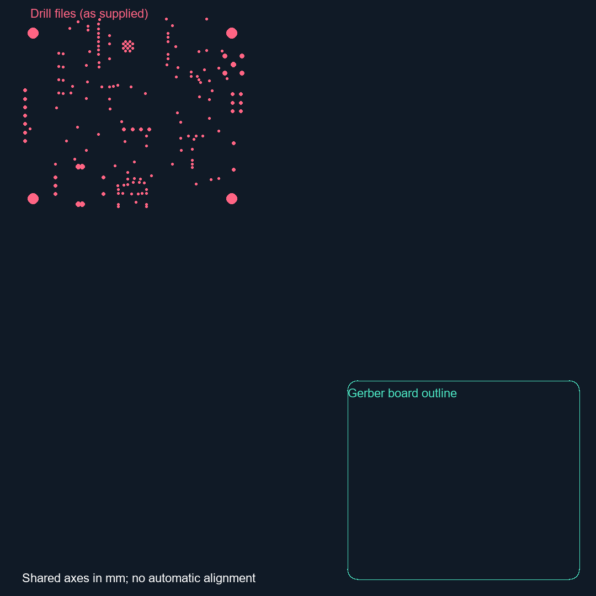

# Kiểm tra Gerber REV1.0 — 09/11/2026

> **Cập nhật sau khi người dùng xuất lại:** lỗi lệch gốc đã được sửa; bộ mới đạt kiểm tra tọa độ và đối chiếu hình học. Xem [kết quả kiểm tra mới](recheck_after_origin_fix/RECHECK.md). Phần bên dưới là báo cáo của bộ file ban đầu, trước lần xuất lại lúc 10:12–10:13.

**Kết luận: chưa gửi nguyên bộ `Gerber_REV1.0` đi đặt hàng. Bộ file đủ lớp nhưng file khoan và Gerber lệch gốc tọa độ.**

Phạm vi: đọc 12 file trong `../Gerber_REV1.0`, đối chiếu PCB/schematic cùng thư mục `layout_manual`, chạy KiCad 10.0.6 DRC trước và sau refill zone trong bộ nhớ. Không lưu thay đổi vào PCB, schematic hoặc Gerber gốc. Các thư mục xuất trong báo cáo chỉ phục vụ kiểm tra, không phải bộ phát hành để sản xuất.

## 1. Lỗi bắt buộc sửa: Gerber và khoan không chung gốc

Gerber Edge.Cuts dùng tọa độ X = 100…170 mm, Y = −110…−50 mm. Hai file Excellon dùng gốc drill/place của PCB ở (100,110) mm, nên tọa độ của lỗ nằm trong vùng X ≈ 0…70 mm, Y ≈ 0…60 mm.

Ví dụ, một lỗ bắt vít có tọa độ `(5,5)` trong NPTH nhưng vị trí tương ứng trong hệ tọa độ Gerber là `(105,−105)` mm. Muốn ghép file khoan hiện tại lên Gerber hiện tại phải tịnh tiến **X +100 mm, Y −110 mm** trong hệ tọa độ CAM. Đây là sai khác gốc, không phải yêu cầu mirror mặt dưới.

Nếu nhà máy nạp nguyên bộ không tự căn lại, lỗ khoan không nằm trên pad/bo. Không dựa vào khả năng nhà máy tự suy đoán và sửa.

Ảnh minh họa trực tiếp trên cùng hệ tọa độ, không tự căn:

**Cách sửa nên dùng:** xuất lại toàn bộ Gerber và drill từ cùng một bản PCB, chọn **Use drill/place file origin** khi Plot Gerber và chọn cùng gốc khi Generate Drill Files. Giữ đúng PTH/NPTH, đơn vị mm, không mirror.

Đã kiểm chứng bằng xuất thử Edge.Cuts với CLI `--use-drill-file-origin`: đường bao chuyển về X = 0…70 mm, Y = 0…60 mm và phù hợp hệ tọa độ của hai file drill hiện có. Đây là phép xuất thử riêng tại `common_origin_check`, chưa thay thế bộ gốc.

Sau khi xuất lại, mở đồng thời tất cả Gerber, PTH và NPTH trong GerbView/CAM viewer; xác nhận bốn lỗ Ø3,2 mm, toàn bộ via, chân header và các rãnh USB/encoder trùng nhau trước khi tạo ZIP đặt hàng.

## 2. Thành phần bộ file và kích thước

| Nội dung | Kết quả |
|---|---|
| Đồng | Đủ F.Cu và B.Cu, PCB 2 lớp |
| Solder mask | Đủ F.Mask và B.Mask |
| Silkscreen | Đủ mặt trên và dưới |
| Đường bao | Một đường bao kín 70 × 60 mm, bốn góc R3 mm |
| Khoan PTH | 158 vị trí: 152 lỗ tròn + 6 rãnh mạ |
| Khoan NPTH | 8 lỗ: 2 × Ø0,65; 2 × Ø1,0; 4 × Ø3,2 mm |
| Paste | Có F.Paste; B.Paste không có hình học, phù hợp không có pad dán mặt dưới |
| Job | Có `.gbrjob` |

Kích thước 70,05 × 60,05 mm trong `.gbrjob` bao gồm bề dày nét Edge.Cuts 0,05 mm; kích thước theo tâm đường biên là **70 × 60 mm**. Thông số thiết kế: FR-4, dày 1,6 mm, đồng 35 µm mỗi mặt. `Finish: None` trong job chưa xác định lớp hoàn thiện bề mặt; chọn thông số thực tế khi đặt hàng.

## 3. Bộ Gerber có đúng bản PCB đang lưu không?

Có, xét về hình học đã xuất. Đã phân tích các lệnh Gerber thành flash, nét và vùng, bỏ khác biệt ngày giờ, thứ tự khai báo aperture và metadata. Cả **9/9 lớp có cùng tập đối tượng hình học** với bộ xuất đối chiếu từ PCB đang lưu. Hai file khoan cũng có cùng vị trí, đường kính và rãnh với bản xuất hiện tại.

Vì vậy, dù timestamp Gerber là 00:30 và timestamp PCB là 09:16 ngày 09/11/2026, không phát hiện khác biệt hình học sản xuất. Timestamp riêng lẻ không phải lý do yêu cầu sửa thiết kế.

Chi tiết và SHA-256 bộ gốc: `gerber_audit.json`. Ảnh `gerber_top_drills_translated_for_review.png` và `gerber_bottom_drills_translated_for_review.png` đã dịch drill (+100,−110) chỉ để quan sát, không phải ảnh của bộ file nguyên trạng.

## 4. DRC và đối chiếu schematic

Chạy với `--severity-all --schematic-parity`; chạy thêm một lần `--refill-zones` nhưng không `--save-board`:

- **0 lỗi mức error, 0 kết nối hở** theo rule hiện tại.
- **8 cảnh báo DRC:** 6 footprint không giống bản thư viện tại R1, R5, R6, R25, TYPE-C, ESP32-S3; 2 cảnh báo silkscreen chồng nhau tại AMS1117 và D7.
- Kết quả DRC trước và sau refill zone giống nhau.
- **20 cảnh báo schematic parity:** 10 missing + 10 extra, do đổi Reference trên PCB.

| Reference schematic | Reference PCB |
|---|---|
| J1 | TYPE-C |
| J2 | UART |
| J3 | OLED |
| J4 | SWDIO |
| J5 | SD SCHOKET |
| J6 | ANTEN |
| SW2 | BOOT |
| SW3 | RESET |
| U1 | ESP32-S3 |
| U2 | AMS1117 |

Đã đối chiếu riêng theo UUID symbol và số chân để loại trừ ảnh hưởng của việc đổi Reference: **207 kết nối chân schematic được kiểm tra, không thiếu component theo UUID và không có net sai khác.** Kết quả lưu tại `netlist_comparison.json`.

Nên giữ Reference nhất quán J1/U1/SW2… giữa PCB và schematic; dùng text silkscreen riêng để ghi tên chức năng. Việc này giúp Update PCB from Schematic, BOM và kiểm tra lắp ráp tránh nhầm lẫn. Không kết luận 20 cảnh báo trên là 20 lỗi nối dây.

Footprint đã chỉnh thủ công cần được chấp nhận có chủ ý hoặc đối chiếu bản vẽ linh kiện thực tế, đặc biệt USB-C và ESP32. DRC không xác nhận kích thước linh kiện mua thực tế.

## 5. Các điểm sản xuất còn cần chú ý

- Nét đồng được xuất nhỏ nhất 0,20 mm. Via định tuyến gồm Ø0,8/lỗ 0,4 mm và Ø1,0/lỗ 0,5 mm. Annular ring hình học nhỏ nhất của pad PTH là 0,20 mm. Đây không phải các kích thước gia công đặc biệt nhỏ đối với PCB FR-4 2 lớp 1 oz.
- Có nét silkscreen 0,12 mm ở mặt trên. Nếu đặt JLCPCB, tài liệu hiện công bố nét legend tối thiểu 0,15 mm và chiều cao chữ 1 mm; nên tăng các nét 0,12 mm lên 0,15 mm và xử lý hai vùng chồng AMS1117/D7. Nguồn: [JLCPCB PCB capabilities](https://jlcpcb.com/capabilities/pcb-capabilities/).
- Rãnh PTH USB rộng 0,6 mm; rãnh encoder rộng 1,5 mm. Giữ chúng trong file PTH, không chuyển thành lỗ NPTH. Với nhà máy khác, kiểm tra lại khả năng và dung sai rãnh theo nhà máy đó.
- DRC không chứng minh USB đạt trở kháng vi sai 90 Ω. Rule hiện có cũng ghi rõ cần xác nhận stackup thực tế với nhà máy; kiểm tra này chưa bao gồm mô phỏng tín hiệu hoặc thử USB/RF/nguồn trên phần cứng.
- Bộ file hiện đủ nội dung cho PCB trần sau khi sửa gốc và chấp nhận các điểm DFM. Nếu đặt lắp ráp, còn cần BOM và pick-and-place đúng Reference/linh kiện thực tế.

## Việc cần làm trước khi đặt

1. Xuất lại Gerber + PTH + NPTH chung gốc tọa độ.
2. Nạp lại cả bộ trong CAM viewer và kiểm tra lỗ/rãnh trùng pad.
3. Xử lý hoặc chấp nhận có kiểm tra các cảnh báo footprint, reference và silkscreen nêu trên.
4. Chọn đúng thông số đơn hàng: 2 lớp, 70 × 60 mm, FR-4 1,6 mm, đồng 1 oz; xác định solder mask, surface finish và yêu cầu USB theo nhu cầu thực tế.

**Bộ nguyên trạng chưa sẵn sàng đặt hàng. Không có lỗi thiếu lớp; lỗi chắc chắn cần sửa là gốc tọa độ giữa Gerber và drill.**
