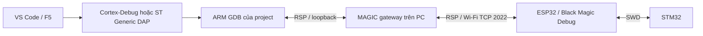

# MAGIC Wi-Fi Probe — tích hợp debugger của project

Extension chạy trên PC, thêm probe ESP32 Wi-Fi/SWD vào **Cortex-Debug** hoặc
**STM32CubeIDE for Visual Studio Code** đang dùng trong project. Sau khi thiết lập,
chọn cấu hình MAGIC trong Run and Debug rồi bấm **F5**. Breakpoint, Variables,
Watch, Call Stack, Continue, Pause và Step vẫn do debugger tiêu chuẩn xử lý.
Firmware probe nằm trong `01_source`; thư mục này không được nạp vào ESP32.



Gateway khởi tạo Black Magic, scan và attach trước khi chuyển nguyên luồng RSP
cho GDB. Cách này giải quyết khác biệt giữa `target remote` của ST Generic và
trình tự `extended-remote → swd_scan → attach` của Black Magic, không tạo một DAP
hoặc bộ máy debug mới. Gateway chỉ nghe trên `127.0.0.1`, dùng cổng tự cấp phát.

## Cài đặt và dùng với project có sẵn

1. Giữ bộ công cụ debug đang dùng trong project. MAGIC không bắt buộc cài
   Cortex-Debug khi dùng bộ ST. Với ST cần **STM32Cube Debug Generic GDB Server**
   (`stmicroelectronics.stm32cube-ide-debug-generic-gdbserver`).
2. Cài `dist/magic-debugger-tool-0.2.0.vsix` qua **Extensions: Install from VSIX…**.
3. Mở workspace STM32 đã tin cậy, đã có cấu hình debug chuẩn trong `launch.json`.
   Đảm bảo cấu hình có dây và bước build hoạt động trước khi tích hợp MAGIC.
4. Cấp nguồn STM32, nối GND/SWDIO/SWCLK với ESP32 chạy firmware probe. PC nối Wi-Fi
   AP của ESP32 hoặc cùng mạng router.
5. Sidebar **MAGIC Probe → Configure Probe**: AP mặc định `192.168.4.1:2022`;
   dùng router thì lấy IP STA thực từ lệnh console `status` của probe.
6. Chọn **Use MAGIC Wi-Fi Probe in Project**, rồi chọn cấu hình debug của project.
   Extension thêm bản `<tên cũ> (MAGIC Wi-Fi)`. Bản có dây, comment JSONC và các
   cấu hình/compound khác được giữ lại.
7. Trong **Run and Debug**, chọn bản MAGIC rồi bấm **F5**. Build/ELF/symbol/GDB,
   thư mục làm việc và source mapping được kế thừa từ project.
8. Dùng thanh debug và các view tiêu chuẩn. Chọn cấu hình cũ để quay lại probe có dây.

Cấu hình Cortex-Debug vẫn có `type: "cortex-debug"`, đổi server thành `external`.
Cấu hình ST chuyển từ backend ST-LINK/J-Link sang **ST Generic**, `type: "stgdbtarget"`,
vẫn sử dụng phần debug của ST. Các trường riêng cho server/probe cũ được bỏ khỏi
bản MAGIC. Tùy chọn thiết bị, SVD, `preBuild`, `preLaunchTask` và biểu thức
`${command:...}`, `${workspaceFolder}`, `${env:...}` được giữ để debugger/VS Code giải.

Danh sách tên cấu hình được tích hợp lưu trong setting resource-scoped
`magicProbe.configurations`. Các cấu hình khác không bị resolver của MAGIC can thiệp.
Sau khi đổi tên bản MAGIC trong launch.json, cập nhật tên tương ứng trong setting này.
Trong workspace nhiều folder, endpoint và danh sách cấu hình được lấy theo folder
của phiên debug, không lấy từ folder đang mở ngẫu nhiên trong editor.

Nếu cấu hình cũ có startup/programming hook riêng cho probe, extension yêu cầu xem
lại hook trước khi tạo profile, thay vì tự chép hoặc tự xóa lệnh đó. Khi preLaunchTask
của project chứa cả bước tự nạp flash, tách phần build trước khi dùng MAGIC launch.

## Launch, attach và nạp flash

- **Attach**: nạp symbol bằng debugger của project, scan/attach target, không tự ghi flash.
- **Launch**: sau khi bước build của project hoàn tất và GDB kết nối gateway, MAGIC
  kiểm tra một ELF standalone F103, nhận dạng chip, backup toàn bộ flash, nạp một
  snapshot ELF bất biến, compare-sections và đọc lại so byte. Sau đó reset-halt và
  bàn giao cho debugger tiêu chuẩn. Native adapter được cấu hình để không nạp lại
  ảnh lần thứ hai và không khởi chạy thêm server của probe cũ.
- **Restart/Reset**: dùng gói Black Magic `vRun` và làm mới cache thanh ghi; không cần
  xung nRST vật lý cho thao tác reset thông thường. Chính sách tiếp tục/dừng theo
  trình tự của debugger. Connect-under-reset vẫn cần dây nRST thật.
- Cortex `loadFiles: []` hoặc ST `imagesAndSymbols: []` cho phép launch không tự nạp.

Nạp flash hiện giới hạn **STM32F103 medium-density 64/128 KiB**, SRAM 20 KiB,
chương trình standalone tại `0x08000000`. BIN/HEX, nhiều load image, image offset,
bootloader offset và các chip khác bị từ chối ở luồng nạp được quản lý. Attach
không áp giới hạn nạp F103 này; phạm vi chip debug thực tế phụ thuộc firmware probe.

Backup và GDB job log nằm trong global storage của extension; đường dẫn backup
được ghi trong **Output → MAGIC Probe**. Nếu mất Wi-Fi/hủy trong lúc nạp, ứng dụng
có thể chưa hoàn chỉnh. Không tự thử nạp lại hoặc reconnect vào phiên cũ. Kiểm tra
Output, kết nối lại rồi bắt đầu phiên mới. Không chạy build khác đồng thời trong lúc nạp.

F5 launch thực hiện nạp theo ý nghĩa cấu hình launch, không hỏi lại mỗi lần. Cần
chọn cấu hình attach khi chỉ muốn quan sát chương trình đang chạy. Lệnh
**Standalone F103 flash and verify** trong Tools vẫn có bước xác nhận như v0.1.
`magicProbe.elfPath`/`gdbPath` phục vụ các công cụ độc lập này; F5 lấy từ project.

## Sở hữu probe và tính năng chưa hỗ trợ

Mỗi cửa sổ chạy một phiên MAGIC; một endpoint chỉ có một chủ sở hữu. Khóa dùng tài nguyên do hệ điều hành sở
hữu, áp dụng giữa các cửa sổ MAGIC trên cùng máy và tự giải phóng nếu host chết.
Scan/flash độc lập bị chặn khi debugger đang dùng probe. Stop chỉ tác động phiên
MAGIC tương ứng. Khóa không quản lý ứng dụng khác hoặc PC khác; các tên DNS/IP
khác nhau trỏ đến cùng probe cũng cần được người dùng thống nhất.

Live Watch có GDB phụ, SWO, RTT, RTOS proxy và chained/multi-core sessions chưa hỗ
trợ. Chúng bị tắt riêng trong profile MAGIC và được thông báo khi tạo profile;
Variables/Watch thông thường vẫn dùng được. Không tự bật lại các tính năng này
trong profile MAGIC. Khi tự sửa startup hook sang lệnh của probe khác, phiên F5
bị từ chối với thông báo cụ thể.

## Phát triển và kiểm thử

Node.js 22 trở lên cho tooling đóng gói. Runtime là JavaScript CommonJS; chỉ có
`jsonc-parser` làm npm dependency runtime để chỉnh launch.json giữ comment.

```powershell
cd D:\esp32_debug\04_extension_for_vscode
npm.cmd ci --ignore-scripts
npm.cmd run check
npm.cmd test
.\tools\open-dev.ps1 -InstallDependency -Backend both
npm.cmd run package
```

Launcher dùng profile **MAGIC Probe Extension Dev**, tách khỏi profile firmware.
`-Backend cortex`, `st`, `both` chọn dependency phục vụ phát triển; MAGIC không
cài thêm debugger vào project tự động. Trong workspace phát triển nhấn F5 để mở
Extension Development Host.

Kiểm tra mạch thật chỉ đọc:

```powershell
npm.cmd run smoke -- <probe-ip>
node tools/gateway-smoke.js <probe-ip> D:\esp32_debug\01_source\.cache\stm32_pc13_blink\pc13_blink.elf
.\tools\test-host.ps1 -Backend st -TrustedTestWorkspace -ProbeHost <probe-ip> `
    -ElfPath D:\esp32_debug\01_source\.cache\stm32_pc13_blink\pc13_blink.elf
```

Runner dùng VS Code đã cài, dependency đã cài và user-data/extensions tách riêng
cho `cortex`, `st`, `both`. `-TrustedTestWorkspace` chỉ áp dụng cho tiến trình test
với cache workspace cố định. Chạy từng backend để kiểm tra không phụ thuộc bộ kia.
Thêm `-Packaged` để cài VSIX cục bộ vào profile test và chạy trên extension đã đóng
gói, thay vì nạp source trong Extension Development Host.
Thêm `-FlashLaunch` chỉ khi muốn **ghi lại ELF mẫu lên F103** để kiểm thử F5 launch;
backup vẫn được tạo trước khi ghi. Đây không phải tùy chọn cần dùng để debug thường ngày.

Host suite kiểm tra cấu hình có dây được giữ, biến đường dẫn được giải, build chạy
một lần, breakpoint/source/Watch, step, native reset và giải phóng gateway. Với
launch test, file ELF cũ được thay bằng dữ liệu không hợp lệ trước build để xác
nhận luồng nạp thực sự dùng kết quả build mới. Unit tests bao gồm JSONC, hook không
tương thích, giới hạn ELF/flash, RSP bootstrap, hủy giữa startup và khóa liên tiến trình.

## Kiểm chứng

Kiểm chứng ngày **26/11/2026** trên VS Code **1.148.0**, Cortex-Debug **1.12.1**,
ST Generic GDB Server **1.5.1**, ARM GDB từ STM32CubeCLT **1.19.0** và F103C8 64 KiB:

| Môi trường | Đã kiểm tra trên mạch thật |
|---|---|
| Chỉ Cortex-Debug | F5 attach và launch; backup 64 KiB, readback verify, build một lần, source/Watch, Step Over, reset |
| Chỉ bộ debug ST, không cài Cortex-Debug | Các kiểm tra attach/launch tương tự, giữ native ST DAP |
| Cả hai cùng cài | Attach bằng từng debugger, source/function breakpoint, Step Over/Into/Out, reset, disconnect |

**23 unit tests đạt**. Host tests cũng kiểm tra lựa chọn endpoint theo folder và
thu hồi gateway khi preLaunchTask thất bại. Backup với đường dẫn chứa dấu cách đã
được thử thật. Phạm vi kiểm chứng là firmware blink mẫu đi kèm; chưa xác nhận mọi
project Cube tùy biến, chip khác, RTOS hoặc probe có dây khác trên phần cứng.
VSIX v0.2.0 cũng đã được cài vào profile test riêng và chạy qua cả hai debugger;
kiểm thử xác nhận extension được nạp từ bản cài, không phải từ source workspace.

## Mã nguồn

| File | Vai trò |
|---|---|
| `src/extension.js` | Chọn cấu hình project, provider F5, sidebar chẩn đoán, theo dõi phiên |
| `src/project-debug.js` | Kế thừa cấu hình và mapping riêng cho Cortex-Debug/ST |
| `src/launch-file.js` | Chèn profile vào JSONC, giữ nguyên entry cũ |
| `src/gateway.js`, `src/rsp.js` | Bootstrap BMD rồi relay RSP cho native GDB |
| `src/probe-lock.js` | Khóa endpoint giữa các process/cửa sổ MAGIC |
| `src/probe-service.js`, `src/workflows.js` | Chẩn đoán và nạp F103 có backup/readback |
| `src/config.js`, `src/gdb.js`, `src/elf.js` | Validate cấu hình, chạy GDB và kiểm tra ELF |
| `test/`, `tools/` | Unit/Extension Host/live tests, development và đóng gói |

Tài liệu giao thức/tích hợp:
[Cortex-Debug attributes](https://github.com/Marus/cortex-debug/blob/v1.12.1/debug_attributes.md),
[ST Generic GDB Server](https://marketplace.visualstudio.com/items?itemName=stmicroelectronics.stm32cube-ide-debug-generic-gdbserver),
[VS Code Debugger API](https://code.visualstudio.com/api/extension-guides/debugger-extension).

Giấy phép GPL-3.0-or-later, xem `LICENSE`. `jsonc-parser` giữ giấy phép MIT kèm theo.
